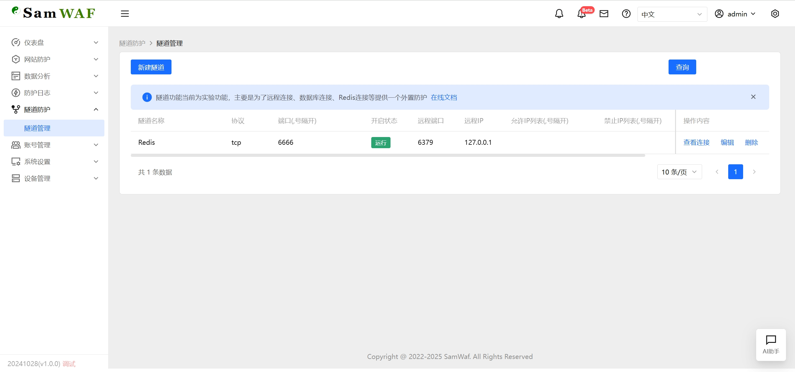
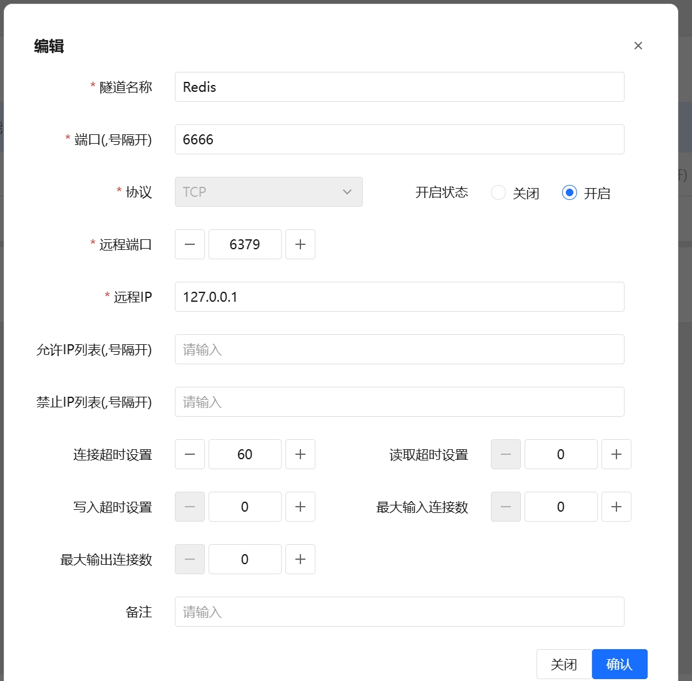
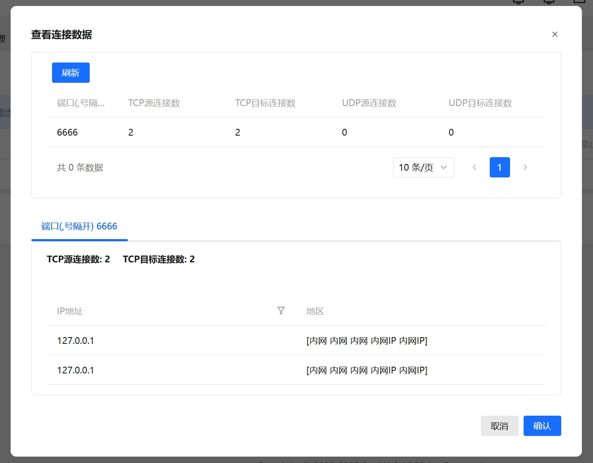

# Tunnel Protection

## 1 Tunnel Protection

Tunnel protection is currently an experimental feature designed to provide external protection for specific ports such as remote connections, database connections, and Redis connections.

### 1.1 Tunnel Management

* View all tunnel configuration information.

### 1.2 Tunnel Maintenance

* **Tunnel Name**
  Custom name of the tunnel used for identification.

* **Port**
  Local listening ports. Multiple ports should be separated by commas, e.g., `3389,22,6379,1433`.

* **Protocol**
  Communication protocol type, commonly `tcp` or `udp`.

* **Remote Port**
  Port number on the remote server.

* **Remote IP**
  IP address of the remote server, e.g., `192.168.1.100`.

* **IP Version Support**
  The IP version the tunnel listens on: `IPv4 Only`, `IPv6 Only`, or `IPv4 & IPv6` (default supports both).

* **SSL Status** (TCP protocol only)
  Whether to enable SSL/TLS on this tunnel port. When enabled, clients must connect to this port via TLS.

* **SSL Certificate / SSL Certificate Key** (required when SSL is enabled)
  The **absolute paths** to the certificate and private key files on the server, e.g. `/home/nginx/cert/test.com.pem`, `/home/nginx/cert/test.com.key`.

* **SSL Protocols** (required when SSL is enabled)
  Allowed TLS protocol versions, e.g. `TLSv1.2 TLSv1.3`.

* **Start Status**
  Whether to enable the tunnel on startup: `On` (enabled) or `Off` (disabled).

* **Connection Timeout**
  Timeout for establishing a connection, in seconds. For example, `10` means 10 seconds.

* **Read Timeout**
  Maximum wait time for reading data from a connection, in seconds.

* **Write Timeout**
  Maximum wait time for writing data to a connection, in seconds.

* **Max Inbound Connections**
  Maximum number of inbound connections allowed. `0` means unlimited.

* **Max Outbound Connections**
  Maximum number of outbound (remote) connections allowed. `0` means unlimited.

* **Remark**
  Optional description or notes for this configuration.

> Access control settings (allowed/denied IPs and allowed time ranges) have moved from the edit form to **Access Protection**; see 1.3 below.

### 1.3 Access Protection

Click **Access Protection** on a tunnel row in the list to open its access protection settings. The dialog header shows the tunnel name, protocol, and whether allowlist mode is currently active. The top-right button jumps to the configuration audit records of this tunnel.

Access checks run in the following order: **fixed deny list → fixed/dynamic allowlist → time ranges → region protection**. Once a check denies the source, later checks are skipped. Changes apply to newly established TCP/TLS connections and subsequent UDP packets; established TCP connections are not disconnected. All checks use the source address as seen by the tunnel.

#### 1.3.1 Access Lists

* **Fixed access lists**
  - **Allowed IPs/CIDRs**: client addresses allowed to access, supporting IPv4/IPv6 and CIDR ranges, separated by commas.
  - **Denied IPs**: client addresses denied access, separated by commas. Takes precedence over the allowed list.
  - **Allowed Time Ranges**: in the format `08:00-10:00;11:00-12:00`. Separate multiple ranges with a semicolon `;`; leave empty for 24/7 access.

  Click **Save fixed lists** to apply. Changes only affect new connections.

* **Dynamic domain allowlist**

  For scenarios where the source address is not fixed (e.g. an office network on a dynamic public IP):

  - Click **Bind domain** to add a domain, choose the address family (IPv4 (A) / IPv6 (AAAA) / dual stack), enable it, and save. Resolution starts after saving.
  - The list check passes if the source matches the fixed allowlist or an effective address of any dynamic domain.
  - **Only public addresses resolved from the domains enter the dynamic allowlist**; enter private or loopback addresses in the fixed allowlist above.
  - An enabled binding keeps allowlist mode active even if resolution is pending, fails, or expires (sources that match no list entry are denied).
  - Resolution uses the system DNS by default. To specify resolver servers, set `security.tunnel_ddns_resolvers` in `conf/config.yml` under the installation directory (numeric IPs or IP:port, comma-separated, up to 3) and restart SamWaf.
  - Each row shows the resolution state (Active / Pending / Partially active / Degraded / Resolution failed / Domain does not exist / No usable addresses / Expired, etc.), the effective IPs, and the last-checked / valid-until times. Click **Resolve now** to trigger a resolution manually, or **Refresh resolution status** for the latest results.
  - Saving changes that remove or disable the last enabled binding while the fixed allowlist is empty requires confirmation; after confirmation allowlist mode turns off and sources passing all other checks are allowed.

#### 1.3.2 Region Protection

Allow or deny access by source country/region:

- After turning on **Enable region protection**, rules run from top to bottom and the first match wins. Turning the switch off keeps the rules but this check no longer denies.
- **No rule matches** and **Unknown country** can each be set to Allow or Deny. Unknown country includes unlocatable sources, private addresses, and sources whose address family has no country database. Make sure setting Deny matches your intent.
- Click **Add rule** to add a rule: name, condition (equals / does not equal), country (searchable), action (allow / deny), and an enabled switch. Use the operation column to move a rule up/down or delete it.
- **Preview draft** lets you pick a country and instantly see whether the current draft would allow or deny that source, so you can verify before saving.
- Click **Save region settings** to apply.

Connections denied by access protection are written to the runtime log in the format `[隧道防护] 拒绝访问：<reason>` (literally "[Tunnel Protection] Access denied: <reason>"), including the protocol, tunnel ID, source IP/port, and server port, which makes it easy to find out why a connection was blocked.

### 1.4 Tunnel Connection Status

* Click **Connections** on a tunnel row to view its current connection status (such as TCP/UDP source connections, target connections, peer IP and region).
 
### 1.5 Example

**How to Protect Remote Desktop Port (e.g., 3389):**

1. **Create a new port (e.g., 3399)** to provide external access;
2. **Hide the actual Remote Desktop port (3389)** behind this new port;
3. **Set up an IP whitelist on port 3399**, allowing only trusted IP addresses to connect;

In this way, only authorized IPs can access port 3399, which then forwards to 3389, effectively securing your Remote Desktop connection.

## Update History

| Date | Applicable Version | Description |
| --- | --- | --- |
| 2026-11-25 | v1.3.26 (beta) | Added tunnel access protection: Access Lists combines fixed allowed/denied IPs, time ranges, and the dynamic domain allowlist (public addresses only); access control fields were removed from the tunnel edit form. Added region protection (allow/deny by country/region, first matching rule wins, with a draft preview). Denied connections are logged with a `[Tunnel Protection]` prefix and the specific reason. |
| 2026-10-14 | v1.3.25-beta.8 | Fixed IPv6 clients being unable to connect to tunnels: connections from IPv6 addresses (such as `::1` resolved from local `localhost`) were always rejected with a "failed to parse client IP" log entry (present from v1.3.18-beta.10 to v1.3.25-beta.7). IPv6 sources now go through the same allowed/denied IP and time-range checks as IPv4. |