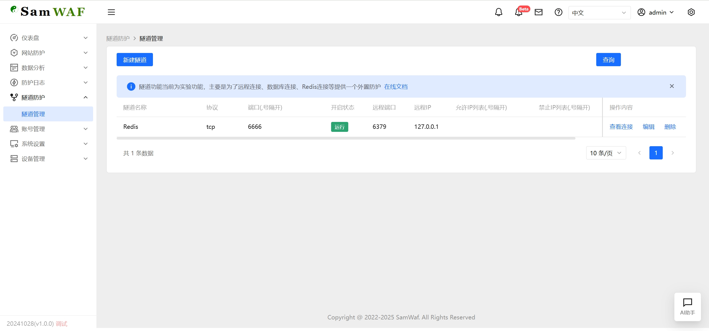
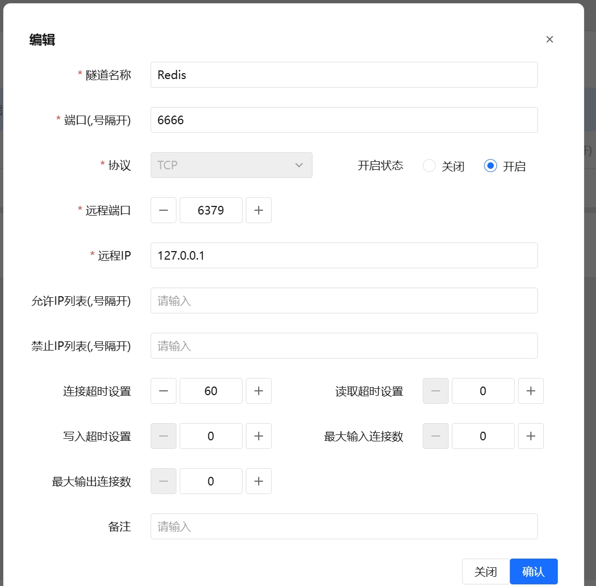
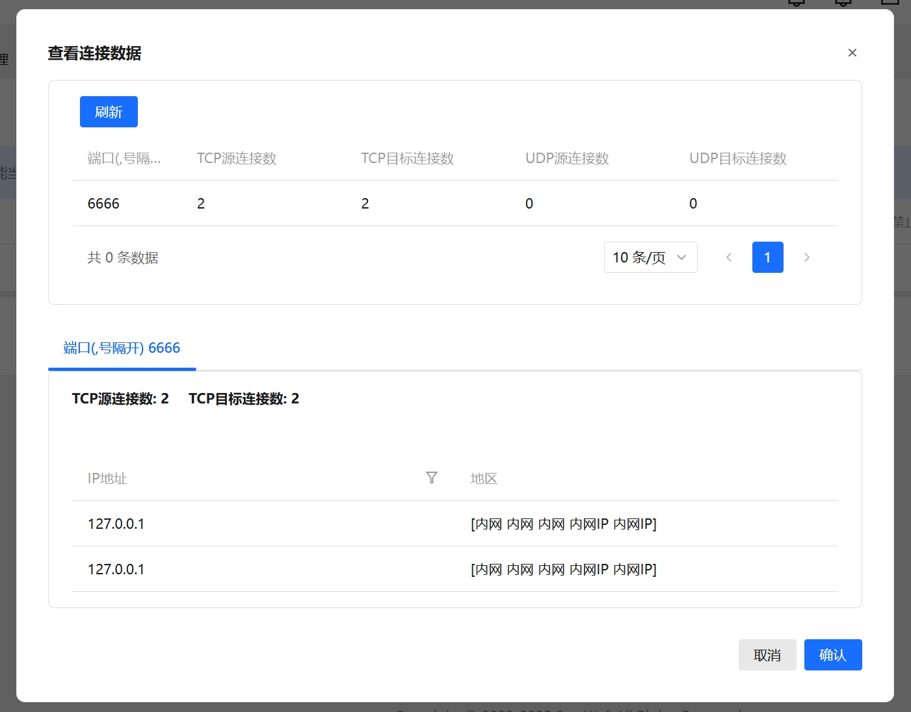

#  隧道防护
 
## 1 隧道防护
 隧道防护当前为实验功能，主要是为了远程连接、数据库连接、Redis连接等特定端口提供一个外置防护。
### 1.1 隧道管理

 
- 查看所有隧道配置情况。
 
### 1.2 隧道维护

 
* **隧道名称**
  隧道的自定义名称，用于标识此配置。

* **端口**
  本地监听端口，多个端口用英文逗号`,`分隔，如 `3389,22,6379,1433`。

* **协议**
  通信协议类型，常见值如 `tcp`、`udp`。

* **远程端口**
  目标服务器的端口号。

* **远程IP**
  目标服务器的IP地址，如 `192.168.1.100`。

* **IP版本支持**
  隧道监听的 IP 版本，可选 `仅IPv4`、`仅IPv6`、`IPv4和IPv6`（默认同时支持 IPv4 和 IPv6）。

* **SSL开关**（仅 TCP 协议可用）
  是否对该隧道端口开启 SSL/TLS。开启后客户端需以 TLS 方式连接此隧道端口。

* **SSL证书路径 / SSL密钥路径**（开启 SSL 后填写）
  服务器上证书与私钥文件的**绝对路径**，如 `/home/nginx/cert/test.com.pem`、`/home/nginx/cert/test.com.key`。

* **SSL协议版本**（开启 SSL 后填写）
  允许的 TLS 协议版本，如 `TLSv1.2 TLSv1.3`。

* **开启状态**
  启动时是否启用该隧道，可选 `开`（开启）或 `关`（关闭）。

* **连接超时设置**
  建立连接的超时时间，单位为秒，如 `10` 表示10秒。

* **读取超时设置**
  从连接中读取数据的最大等待时间，单位为秒。

* **写入超时设置**
  向连接中写入数据的最大等待时间，单位为秒。

* **最大输入连接数**
  允许进入隧道的最大连接数量，0 表示不限制。

* **最大输出连接数**
  隧道可建立的最大远程连接数量，0 表示不限制。

* **备注**
  可填写备注信息用于说明配置用途。

> 允许/禁止 IP 与允许访问时间段等访问控制配置已从编辑表单移至 **访问防护**，见下文 1.3。

### 1.3 访问防护

在隧道列表某行点击 **访问防护**，即可打开该隧道的访问防护配置。弹窗顶部显示隧道名称、协议以及当前是否处于白名单模式，右上角可跳转查看本隧道的配置审计记录。

访问检查按以下顺序执行：**固定禁止名单 → 固定/动态白名单 → 访问时段 → 地区防御**。前一项被拒绝后不再执行后续检查。变更应用于新建立的 TCP/TLS 连接和后续 UDP 报文，不会主动断开已建立的 TCP 连接；所有检查都以隧道实际看到的来源地址为准。

#### 1.3.1 访问名单

* **固定访问名单**
  - **允许 IP/CIDR**：允许访问的客户端地址，支持 IPv4/IPv6 与 CIDR 网段，多个用英文逗号隔开。
  - **禁止 IP**：拒绝访问的客户端地址，多个用英文逗号隔开，优先级高于允许名单。
  - **允许访问时间段**：格式为 `08:00-10:00;11:00-12:00`，多个时间段用英文分号 `;` 隔开；留空表示 24 小时可访问。

  修改后点击 **保存固定名单** 生效，仅对新连接起作用。

* **动态域名白名单**

  适用于来源地址不固定的场景（如动态公网 IP 的办公网络）：

  - 点击 **绑定域名** 添加域名，选择地址族（IPv4(A) / IPv6(AAAA) / 双栈）并启用，保存后开始解析。
  - 命中固定允许名单或任一动态域名的当前有效地址，即可通过名单检查。
  - **只有解析到的公网地址会进入动态白名单**；内网、回环等地址请填写到上方固定允许名单。
  - 已启用的域名即使尚未解析成功、失败或过期，白名单模式仍然生效（未命中名单的来源将被拒绝）。
  - 域名解析默认使用系统 DNS；如需指定解析服务器，可在安装目录 `conf/config.yml` 的 `security.tunnel_ddns_resolvers` 中配置（数字 IP 或 IP:端口，英文逗号分隔，最多 3 个），修改后需重启 SamWaf 生效。
  - 每行显示解析状态（生效中 / 待解析 / 部分生效 / 解析异常 / 解析失败 / 域名不存在 / 无可用地址 / 已过期等）、生效 IP 与最近检查、有效至时间；可点击 **立即解析** 手动触发一次解析，或点 **刷新解析状态** 查看最新结果。
  - 保存时若会移除或停用最后一条启用的动态绑定、且固定允许名单为空，需要二次确认；确认后将关闭白名单模式，符合其他访问限制的来源即可访问。

#### 1.3.2 地区防御

按来源国家/地区允许或拒绝访问：

- 打开 **启用地区防御** 开关后，规则自上而下执行，首条命中生效；关闭开关仅保留规则，本步骤不再拒绝。
- **未命中规则** 与 **国家未知** 可分别设置动作（允许 / 禁止）。国家未知包括无法定位的来源、私有地址以及缺少对应地址族国家库时的来源，设置为「禁止」时请确认符合预期。
- 点击 **新增规则** 添加规则：规则名称、条件（等于 / 不等于）、国家（可搜索选择）、动作（允许 / 禁止）、启用开关；操作列可上移/下移调整顺序或删除。
- **预演草稿** 可选择一个国家，实时查看按当前草稿规则该来源会通过还是被拒绝，保存前即可验证效果。
- 修改后点击 **保存地区配置** 生效。

被访问防护拒绝的连接会写入运行日志，格式为 `[隧道防护] 拒绝访问：<原因>`，包含协议、隧道标识、来源 IP/端口与服务端口，便于排查拦截原因。

### 1.4 隧道连接情况

 
- 在隧道列表某行点击 **查看连接**，即可查看该隧道当前的连接情况（如 TCP/UDP 源连接数、目标连接数、对端 IP 与地区等）。
 
### 1.5 示例

**防护远程桌面端口（如3389）的方法：**
 

1. **新建一个端口（如3399）**，对外提供访问；
2. 将真实的远程桌面端口 **3389 隐藏在后面**；
3. 在 3399 端口上设置 **IP 白名单**，仅允许指定 IP 访问；

这样，只有被允许的 IP 才能通过 3399 转发访问 3389，从而实现远程桌面的安全防护。

## 更新记录

| 日期 | 适用版本 | 说明 |
| --- | --- | --- |
| 2026-11-25 | v1.3.26（beta） | 新增隧道访问防护：访问名单整合固定允许/禁止 IP、访问时段与动态域名白名单（只收公网地址），编辑表单不再包含访问控制字段；新增地区防御（按国家/地区允许或拒绝，规则首条命中，支持预演草稿）；被拦截的访问在运行日志中以 `[隧道防护]` 前缀输出具体原因。 |
| 2026-10-14 | v1.3.25-beta.8 | 修复 IPv6 客户端无法连接隧道的问题：以 IPv6 地址（如本机 `localhost` 解析出的 `::1`）连接隧道端口时会被直接拒绝，日志出现「解析客户端IP失败」（v1.3.18-beta.10 ~ v1.3.25-beta.7 存在此问题）。修复后 IPv6 来源与 IPv4 一样进入允许/禁止 IP 与访问时间段的正常判定。 |
